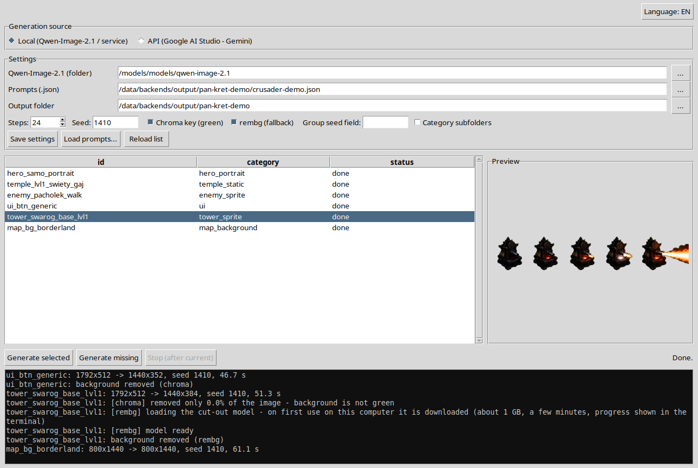

# Qwen Asset Studio

**Batch-generate 2D game assets on your own GPU** – sprites, animation strips, buildings, UI elements,
map backgrounds and cutscene slides – from simple JSON prompt files, with automatic background removal.

Runs the open **Qwen-Image-2.1** model locally (or the Gemini API, if you prefer). Two desktop apps,
English / Polish interface, no cloud account needed for local generation.

🇵🇱 [Wersja polska](README.pl.md)


<sub>Everything above was generated by this tool from the template prompt files in this repo, transparent
backgrounds removed automatically. The raised-sword warrior was made with Edit Studio from the portrait next to it.</sub>

---

## What's inside

| App | What it does |
|---|---|
| **Studio** (`run.sh`) | Loads a prompt file, shows the asset list, generates what's missing, removes backgrounds, shows a live preview |
| **Edit Studio** (`run_edit_ui.sh`) | Takes an existing image + an instruction ("same character, now raising his sword") and makes variants – poses, animation frames, damage states |
| `generuj.py`, `edit_backend.py` | The same two jobs from the command line, no window |





### Features

- **Prompt files instead of clicking** – one JSON file = one asset set. Re-run any time: finished files are skipped.
- **Seven ready-made templates** (from the game *Crusader Defence*) – UI, characters, buildings, map backgrounds,
  cutscene slides, 3-frame animation strips, an animated tower. Copy one and replace the prompts with your own.
- **Automatic background removal** – green-screen keying with an object mask, `rembg` as a fallback (details below).
- **Any size** – exact `resolution` or any `aspect_ratio`; the tool generates at a size the model likes and
  scales to your target.
- **Consistent families** – a fixed seed per group (e.g. all frames of one unit) for a more uniform look.
- **Local model as a service** – starts on the first request, keeps the model on the GPU(s), shuts down after
  10 minutes of inactivity and frees the VRAM.
- **Optional Gemini API mode** (Google AI Studio key) – for machines without a big GPU.
- **English / Polish UI** – one button, switches instantly.

---

## Requirements

- **Linux** (tested on Ubuntu 24.04) with Python **3.11+**. Windows works too – see
  [`JAK_NA_WINDOWS.txt`](JAK_NA_WINDOWS.txt) (step-by-step guide, in Polish).
- **NVIDIA GPU(s)** with a driver supporting CUDA 12.8. The default setup splits the model over two cards
  (24 GB + 20 GB); a single 48 GB card works too – set `MAX_MEMORY` in the service.
- ~35 GB of disk for the model weights, ~10 GB for the Python environments, ~1 GB for the `rembg` model
  (downloaded automatically on first use).

Measured speed on RTX 3090 + RTX 3080, 24 steps: **45–60 s per image** (1024×1024 up to 1792×512),
about 80 s for an edit.

## Installation (Linux, short version)

```bash
sudo apt install python3-venv python3-tk git

# 1. model folder + service files
mkdir -p /models/models/qwen-image-2.1
cp backend_linux/qwen_service/* /models/models/qwen-image-2.1/

# 2. the model's own Python environment
cd /models/models/qwen-image-2.1
python3 -m venv venv-linux
./venv-linux/bin/pip install --upgrade pip
./venv-linux/bin/pip install -r req-linux-torch.txt
./venv-linux/bin/pip install -r req-linux.txt

# 3. the weights (~32 GB)
./venv-linux/bin/hf download Qwen/Qwen-Image-2.1 --local-dir .

# 4. the apps
cd <this repo>/backend_linux
./setup.sh
./run.sh            # Studio
./run_edit_ui.sh    # Edit Studio
```

If the model lives somewhere else, set it in the app (*Qwen-Image-2.1 (folder)*) or `export QWEN21_DIR=...`.
Full reference – every setting, prompt fields, manifests, troubleshooting: [`backend_linux/README.md`](backend_linux/README.md) (Polish).

## Prompt files

```json
{
  "global": { "negative": "text, letters, watermark, logo" },
  "assets": [
    {
      "id": "hero_portrait",
      "category": "hero",
      "resolution": "768x768",
      "background": "transparent",
      "prompt": "Portrait of a bearded Slavic warrior in a fur cloak ... Transparent background on #00FF00."
    }
  ]
}
```

`id` becomes the file name, `background: "transparent"` turns on background removal. Describe everything –
style, colours, frames of an animation – inside each `prompt`; extra fields in the templates are notes only.

---

## Background removal – how it works and where it fails

Ask for a green screen in every transparent asset: end the prompt with **"Transparent background on #00FF00."**
(all templates do).

1. **Chroma key with an object mask** – removes the green, then fills the inside of the object's outline, so green
   *enclosed* by the object survives (a green progress bar inside a frame, a green tunic, grass on top of a logo).
   Holes in the background colour stay transparent (inside letters, gaps between branches). 2 px soft edge.
2. **rembg** takes over when the background was not green (the key removed less than 5 % of the image).

### ⚠️ Known limitations

- **Green close to the background colour, at the object's edge, is removed together with the background.**
  A green leaf sticking out of the silhouette, a lime-green element touching the outline, a green glow – may come out
  with holes or missing. If an asset is mostly green, generate it with *Chroma key* unticked (rembg is used instead) or fix it by hand.
- **Dark objects on a black background** (prompt without `#00FF00`) are cut poorly by rembg – parts of the object can
  disappear. Always ask for the green background.
- The model sometimes paints a dark-green or turquoise background instead of pure green; the tool handles that, but
  check the result of every transparent asset before using it.
- Multi-frame strips (animations) are generated as one image – how different the frames are depends on the prompt.

---

## Licenses

**This code** is released into the public domain under [The Unlicense](LICENSE) – do whatever you want with it.

**The models it downloads have their own licenses.** Read them before you use the tool – a short summary:

| Model | License | Commercial use |
|---|---|---|
| [Qwen-Image-2.1](https://huggingface.co/Qwen/Qwen-Image-2.1) (generation, editing) | Qwen Research License | Use of the model is limited to non-commercial purposes, which the license defines as *"research or evaluation"*. The license covers the model (weights, code, docs) and does not claim the generated images. Commercial use of the model needs a separate license from Alibaba (model-business@notice.qwencloud.com) |
| [RMBG-2.0](https://huggingface.co/briaai/RMBG-2.0) (`bria-rmbg`, default model of `rembg`) | CC BY-NC 4.0 | Non-commercial only (not primarily intended for commercial advantage); commercial license from BRIA |
| [rembg](https://github.com/danielgatis/rembg) (the library) | MIT | yes |
| Gemini API (optional mode) | Google's API terms | see Google AI Studio terms |

This project is not affiliated with Alibaba / Qwen, BRIA or Google.
