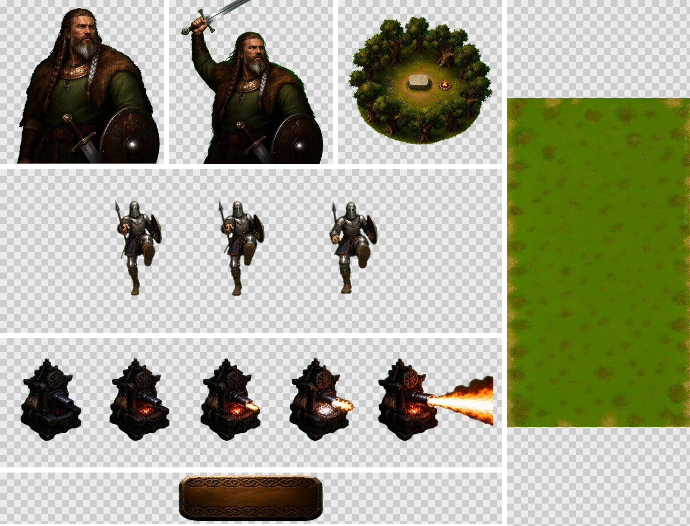
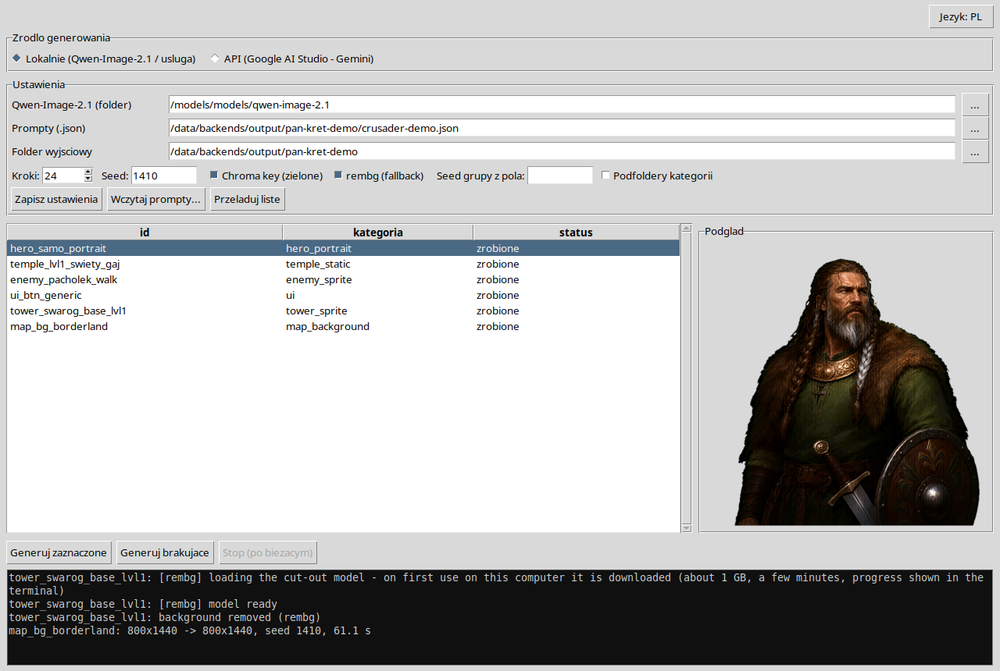
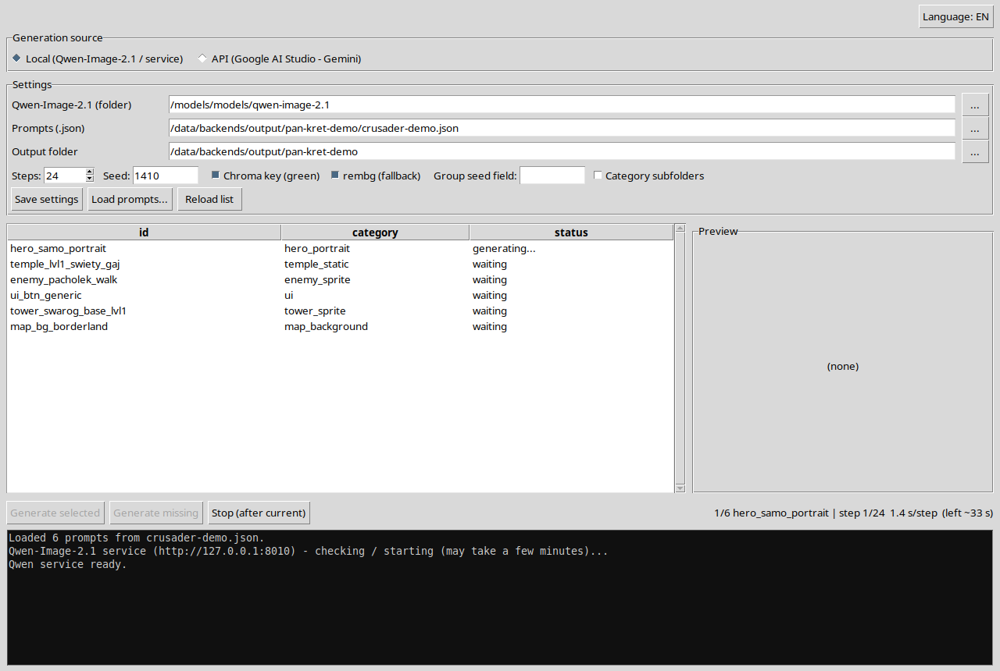
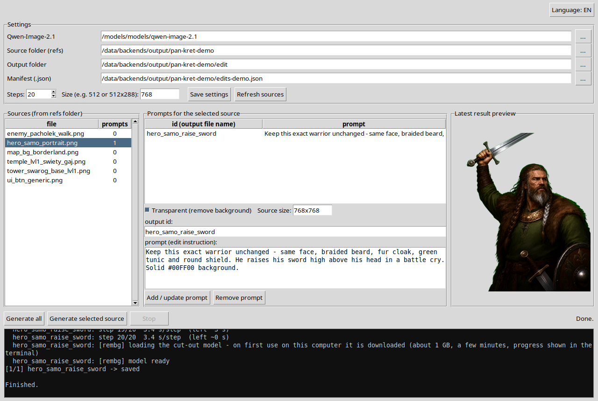

# Qwen Asset Studio

**Seryjne generowanie grafik 2D do gier na własnej karcie graficznej** – sprite'y, paski animacji, budynki,
elementy interfejsu, tła map i slajdy do scenek – z prostych plików JSON z promptami, z automatycznym wycinaniem tła.

Działa na otwartym modelu **Qwen-Image-2.1** lokalnie (albo przez API Gemini, jeśli wolisz). Dwa programy z okienkami,
interfejs po polsku i angielsku, do generowania lokalnego nie trzeba żadnego konta w chmurze.

🇬🇧 [English version](README.md)


<sub>Wszystko powyżej wygenerował ten program z plików-wzorów z tego repo, przezroczyste tło wycięte automatycznie.
Wojownik z uniesionym mieczem powstał w Edit Studio z portretu obok.</sub>

---

## Co jest w środku

| Program | Do czego |
|---|---|
| **Studio** (`run.sh`) | Wczytuje plik z promptami, pokazuje listę grafik, generuje brakujące, wycina tło, pokazuje podgląd na żywo |
| **Edit Studio** (`run_edit_ui.sh`) | Bierze istniejący obrazek + polecenie („ta sama postać, teraz unosi miecz”) i robi warianty – pozy, klatki animacji, stany zniszczenia |
| `generuj.py`, `edit_backend.py` | To samo z linii poleceń, bez okna |







### Możliwości

- **Pliki z promptami zamiast klikania** – jeden plik JSON = jeden zestaw grafik. Można przerwać i wrócić: gotowe pliki są pomijane.
- **Siedem gotowych wzorów** (z gry *Crusader Defence*) – interfejs, postacie, budynki, tła map, slajdy do scenek,
  animacje w paskach po 3 klatki, wieża z animacją. Skopiuj wzór i podmień prompty na własne.
- **Automatyczne wycinanie tła** – klucz zieleni z maską obiektu, `rembg` jako ratunek (szczegóły niżej).
- **Dowolny rozmiar** – dokładne `resolution` albo dowolne `aspect_ratio`; program generuje w rozmiarze wygodnym dla
  modelu i skaluje do docelowego.
- **Spójne rodziny grafik** – stały seed dla grupy (np. wszystkie klatki jednej jednostki).
- **Model lokalny jako usługa** – startuje przy pierwszym zapytaniu, trzyma model na kartach, po 10 minutach
  bezczynności sam się zamyka i zwalnia pamięć karty.
- **Opcjonalny tryb API Gemini** (klucz z Google AI Studio) – dla komputerów bez mocnej karty.
- **Interfejs PL / EN** – jeden przycisk, przełącza od razu.

---

## Wymagania

- **Linux** (testowane na Ubuntu 24.04), Python **3.11+**. Na Windows też działa – instrukcja krok po kroku:
  [`JAK_NA_WINDOWS.txt`](JAK_NA_WINDOWS.txt) (wersja angielska: [`WINDOWS_INSTALL.txt`](WINDOWS_INSTALL.txt)).
- **Karta (karty) NVIDIA** ze sterownikiem obsługującym CUDA 12.8. Domyślnie model jest rozłożony na dwie karty
  (24 GB + 20 GB); jedna karta 48 GB też wystarczy – ustaw `MAX_MEMORY` w usłudze.
- Ok. 35 GB na wagi modelu, ok. 10 GB na środowiska Pythona, ok. 1 GB na model `rembg` (pobiera się sam przy pierwszym użyciu).

Zmierzona szybkość na RTX 3090 + RTX 3080, 24 kroki: **45–60 s na obrazek** (od 1024×1024 do 1792×512),
ok. 80 s na edycję.

## Instalacja (Linux, w skrócie)

```bash
sudo apt install python3-venv python3-tk git

# 1. folder modelu + pliki usługi
mkdir -p /models/models/qwen-image-2.1
cp backend_linux/qwen_service/* /models/models/qwen-image-2.1/

# 2. osobne środowisko Pythona modelu
cd /models/models/qwen-image-2.1
python3 -m venv venv-linux
./venv-linux/bin/pip install --upgrade pip
./venv-linux/bin/pip install -r req-linux-torch.txt
./venv-linux/bin/pip install -r req-linux.txt

# 3. wagi (~32 GB)
./venv-linux/bin/hf download Qwen/Qwen-Image-2.1 --local-dir .

# 4. programy
cd <to repo>/backend_linux
./setup.sh
./run.sh            # Studio
./run_edit_ui.sh    # Edit Studio
```

Jeśli model leży gdzie indziej, wpisz folder w programie (*Qwen-Image-2.1 (folder)*) albo `export QWEN21_DIR=...`.
Pełny opis – wszystkie ustawienia, pola promptów, manifesty, rozwiązywanie problemów: [`backend_linux/README.md`](backend_linux/README.md).

## Pliki z promptami

```json
{
  "global": { "negative": "text, letters, watermark, logo" },
  "assets": [
    {
      "id": "hero_portrait",
      "category": "hero",
      "resolution": "768x768",
      "background": "transparent",
      "prompt": "Portrait of a bearded Slavic warrior in a fur cloak ... Transparent background on #00FF00."
    }
  ]
}
```

`id` to nazwa pliku wynikowego, `background: "transparent"` włącza wycinanie tła. Wszystko – styl, kolory, klatki
animacji – opisz w samym `prompt`; dodatkowe pola we wzorach to tylko notatki.

---

## Wycinanie tła – jak działa i gdzie zawodzi

W każdej przezroczystej grafice poproś o zielone tło: zakończ prompt zdaniem **„Transparent background on #00FF00.”**
(tak robią wszystkie wzory).

1. **Klucz zieleni z maską obiektu** – wycina zieleń, potem wypełnia wnętrze konturu obiektu, więc zieleń **otoczona**
   obiektem zostaje (zielony pasek w ramce, zielona tunika, trawa nad logo). Dziury w kolorze tła zostają przezroczyste
   (środki liter, prześwity między gałązkami). Miękka krawędź 2 px.
2. **rembg** przejmuje wycinanie, gdy tło nie było zielone (klucz usunął mniej niż 5% obrazka).

### ⚠️ Znane ograniczenia

- **Zieleń w kolorze bliskim tłu, na krawędzi obiektu, jest wycinana razem z tłem.** Zielony listek wystający poza
  sylwetkę, jasnozielony element dotykający konturu, zielona poświata – mogą wyjść z dziurami albo zniknąć. Jeśli grafika
  jest w dużej części zielona, wygeneruj ją z odznaczonym *Chroma key* (wtedy wycina rembg) albo popraw ręcznie.
- **Ciemne obiekty na czarnym tle** (prompt bez `#00FF00`) rembg wycina słabo – części obiektu mogą zniknąć. Zawsze proś
  o zielone tło.
- Model czasem maluje tło ciemnozielone albo turkusowe zamiast czystej zieleni; program sobie z tym radzi, ale sprawdź
  każdą przezroczystą grafikę przed użyciem.
- Paski z kilkoma klatkami (animacje) powstają jako jeden obrazek – to, jak bardzo klatki się różnią, zależy od promptu.

---

## Licencje

**Ten kod** jest w domenie publicznej na licencji [The Unlicense](LICENSE) – rób z nim, co chcesz.

**Modele, które pobiera, mają własne licencje.** Przeczytaj je, zanim zaczniesz używać programu – w skrócie:

| Model | Licencja | Użytek komercyjny |
|---|---|---|
| [Qwen-Image-2.1](https://huggingface.co/Qwen/Qwen-Image-2.1) (generowanie, edycja) | Qwen Research License | Używanie modelu tylko w celach niekomercyjnych, które licencja definiuje jako *„research or evaluation”* (badania i testy). Licencja dotyczy modelu (wagi, kod, dokumentacja) i nie obejmuje wygenerowanych obrazków. Do komercyjnego używania modelu potrzebna jest osobna licencja od Alibaby (model-business@notice.qwencloud.com) |
| [RMBG-2.0](https://huggingface.co/briaai/RMBG-2.0) (`bria-rmbg`, domyślny model `rembg`) | CC BY-NC 4.0 | Tylko niekomercyjnie (nie dla zysku); licencja komercyjna od BRIA |
| [rembg](https://github.com/danielgatis/rembg) (biblioteka) | MIT | tak |
| API Gemini (tryb opcjonalny) | warunki API Google | patrz warunki Google AI Studio |

Projekt nie jest powiązany z Alibabą / Qwen, BRIA ani Google.
